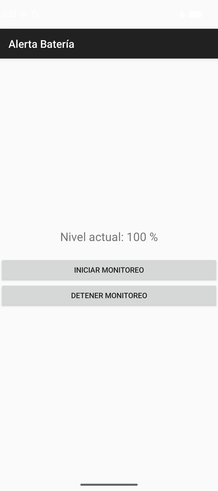
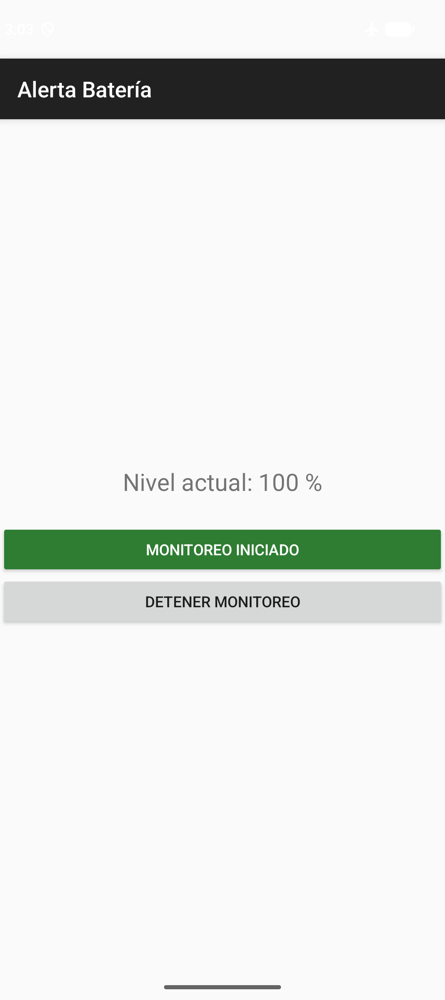
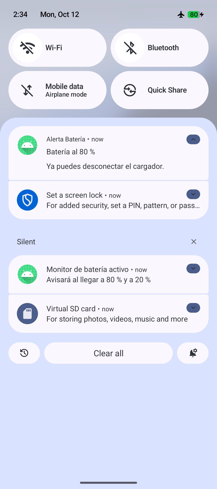
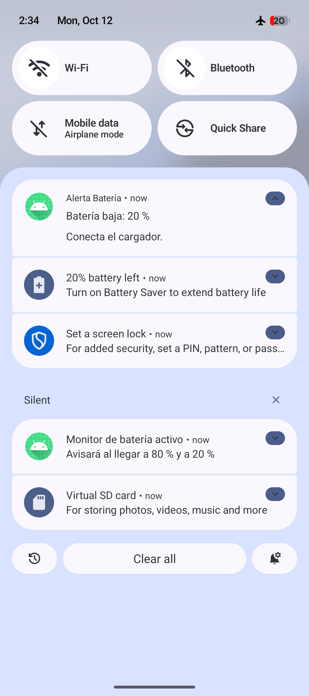

# Alerta Batería

Aplicación Android en Kotlin que avisa con un **mensaje de voz al 80 %** cuando el teléfono está cargando y con otro **al 20 %** cuando se está descargando. Su objetivo es ayudar a mantener la batería entre el 20 % y el 80 % para prolongar su vida útil, sin necesidad de root.

<p align="center">
  
  
  
  
</p>

## Funcionalidades

- Muestra el nivel de batería actual, actualizado en vivo mientras la app está abierta.
- Botones para iniciar y detener el monitoreo. Mientras el monitoreo está activo, el botón de inicio se pone verde y dice "Monitoreo iniciado"; el estado se mantiene al cerrar y volver a abrir la app.
- Alerta al 80 % con el cargador conectado: **mensaje de voz** "Batería al 80 por ciento. Ya puedes desconectar el cargador." y aviso en la barra de notificaciones.
- Alerta al 20 % con el cargador desconectado: **mensaje de voz** "Batería baja, al 20 por ciento. Conecta el cargador." y aviso en la barra de notificaciones.
- Si la voz en español no está disponible o falla, suena un tono de respaldo: el de notificación al 80 % y el de alarma al 20 %.
- La voz y los tonos usan el volumen de **alarma**, para escucharse aunque el volumen multimedia esté bajo. Si el volumen de alarma está por debajo del 80 % del máximo, la app lo **sube automáticamente** mientras suena la alerta y luego lo devuelve a su nivel anterior.
- Histéresis de 2 puntos: la alerta no se repite mientras el nivel oscila alrededor del umbral.
- El monitoreo se reanuda solo al reiniciar el teléfono o al actualizar la app, si estaba activo.
- La app no usa internet ni recolecta datos personales.

## Cómo funciona

| Clase | Función |
|---|---|
| `MainActivity` | Interfaz: muestra el nivel, pide el permiso de notificaciones, inicia o detiene el servicio y refleja el estado en el botón de inicio. |
| `BatteryMonitorService` | Servicio en primer plano (`specialUse`) que escucha `ACTION_BATTERY_CHANGED`, evalúa los umbrales, dice los mensajes de voz con `TextToSpeech` (o el tono de respaldo), con uso de audio `ALARM`. |
| `BootReceiver` | Vuelve a lanzar el servicio tras `BOOT_COMPLETED` (reinicio) y `MY_PACKAGE_REPLACED` (actualización de la app) si el monitoreo estaba activo. |

La app no consulta el nivel en bucle: solo reacciona a los avisos del sistema, por lo que su consumo es despreciable.

**Reglas de disparo y rearme**

| Alerta | Se dispara cuando… | Se rearma cuando… |
|---|---|---|
| 80 % | El cargador está conectado y el nivel es ≥ 80 %. | Se desconecta el cargador o el nivel baja de 78 %. |
| 20 % | El cargador está desconectado y el nivel es ≤ 20 %. | Se conecta el cargador o el nivel sube de 22 %. |

## Requisitos

- Android 8.0 (API 26) o superior.
- Para compilar: Android Studio reciente (AGP 9.4, `compileSdk`/`targetSdk` 37).

## Compilar e instalar

Abre la carpeta del proyecto en Android Studio y ejecuta la configuración `app`, o desde la terminal:

```bash
./gradlew assembleDebug
```

```bash
adb install -r app/build/outputs/apk/debug/app-debug.apk
```

Al abrir la app, acepta el permiso de notificaciones (Android 13+) y pulsa **Iniciar monitoreo**. El botón cambiará a verde con el texto **Monitoreo iniciado**. Para detenerlo, pulsa **Detener monitoreo** y el botón volverá a su estado original.

## Probar sin esperar a que cargue la batería

Con un emulador o un teléfono conectado por USB se puede simular el nivel con `adb`:

```bash
# Cargador conectado: rearmar en 75 % y subir a 80 % (debe sonar)
adb shell dumpsys battery set ac 1
adb shell dumpsys battery set level 75
adb shell dumpsys battery set level 80

# Cargador desconectado: bajar de 21 % a 20 % (debe sonar)
adb shell dumpsys battery unplug
adb shell dumpsys battery set level 21
adb shell dumpsys battery set level 20

# Restaurar los valores reales
adb shell dumpsys battery reset
```

### Resultados de las pruebas

Probado en un emulador Pixel 10 y en un Pixel 10 físico, ambos con Android 17 (API 37):

| Caso | Prueba | Resultado |
|---|---|---|
| P1 | Conectado, el nivel sube de 79 % a 80 % | ✅ Se escucha la alerta y aparece "Batería al 80 %" |
| P2 | Conectado, el nivel pasa a 81 %, 79 % y 80 % | ✅ No vuelve a sonar |
| P3 | Desconectado, el nivel baja de 21 % a 20 % | ✅ Se escucha la alerta y aparece "Batería baja: 20 %" |
| P4 | En 20 %, se conecta el cargador | ✅ No suena; la alerta se rearma |
| P5 | Reiniciar con el monitoreo activo | ✅ Reaparece la notificación del servicio |
| P6 | Rechazar el permiso de notificaciones | ✅ Suena, pero no se muestra la notificación |
| P7 | 80 % y 20 % con la voz en español disponible | ✅ Se escucha el mensaje de voz de cada alerta (probado en el celular) |
| P8 | 80 % sin la voz en español descargada | ✅ La voz falla y suena el tono de notificación de respaldo |
| P9 | 20 % con el motor de voz desactivado | ✅ Suena el tono de alarma de respaldo |
| P10 | Actualizar la app con el monitoreo activo | ✅ El monitoreo se reanuda solo, sin abrir la app |
| P11 | Alerta con el volumen de alarma en 2 de 7 | ✅ Sube a 6 de 7 mientras habla y se restaura al terminar (probado en el celular) |

Las capturas están en la carpeta [`pruebas/`](pruebas).

### Diagnóstico

El servicio registra en el log del sistema cuándo arranca o se detiene, cada cambio de nivel o de cargador y cada alerta, con la etiqueta `AlertaBateria`. Para verlos con el teléfono conectado:

```bash
adb logcat -s AlertaBateria
```

## Limitaciones conocidas

- Algunas capas de fabricante (MIUI/HyperOS, EMUI, One UI) cierran servicios en segundo plano. Conviene excluir la app de la optimización de batería y, en Xiaomi, activar el inicio automático.
- Si el usuario pulsa "No permitir" en el permiso de notificaciones, Android bloquea todas las notificaciones de la app, incluida la del servicio, hasta que se vuelvan a activar en Ajustes.
- Si el sistema reinicia el servicio, la alerta podría repetirse una vez, porque el estado de las alertas no se guarda.
- El modo No molestar puede silenciar el sonido según la configuración del usuario.
- Android no deja que una app baje el volumen de alarma por debajo de su mínimo (3 de 7 en un Pixel). Si el usuario lo tenía más bajo, tras una alerta queda en ese mínimo en lugar de su valor original.
- El mensaje de voz necesita que el motor de texto a voz del teléfono tenga la voz en español instalada. Google la descarga la primera vez que se usa (requiere internet en ese momento); mientras no esté disponible, suena el tono de respaldo.
- Para publicar en Google Play hay que justificar el tipo de servicio `specialUse`. Para uso personal o académico no es necesario.

## Documentación

El planteamiento, los antecedentes de código abierto, el diseño y el plan de pruebas están en [`Proyecto_Alerta_Bateria_Android.docx`](Proyecto_Alerta_Bateria_Android.docx).

## Licencia

Este proyecto se distribuye bajo la [licencia MIT](LICENSE): puedes usar, copiar, modificar y distribuir el código libremente, incluso con fines comerciales, siempre que conserves el aviso de autoría y la licencia.

## Autor

Barlen Porfirio David Calderón Curi — Chincheros, Apurímac, Perú (2026).
